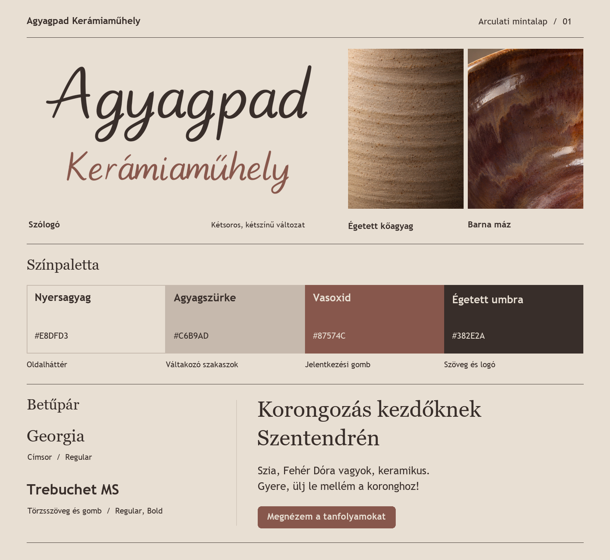

# Agyagpad Kerámiaműhely – webes arculat

A szentendrei műhely weboldalán a világos, nyersagyagszínű felületek adják a helyet a kerámiáknak. A kézjegy a logóban jelenik meg, az anyag karaktere a képeken, a vasoxidvörös kiemelés pedig a tanfolyamválasztáshoz és a jelentkezéshez vezeti a látogatót.



## Színpaletta

| Szín | HEX | Webes szerep |
| --- | --- | --- |
| Nyersagyag | `#E8DFD3` | Az oldal fő háttere, világos felirat a vasoxid gombon és az umbra felületeken. |
| Agyagszürke | `#C6B9AD` | Másodlagos, barnásszürke háttér, például a tanfolyamok közös sávjához. |
| Vasoxid | `#87574C` | Elsődleges gomb és a kétszínű logó „Kerámiaműhely” szava. |
| Égetett umbra | `#382E2A` | Címsor, törzsszöveg, navigáció és sötét háttér. |

Hosszabb olvasáshoz nyersagyag alapon umbra szöveget használj. A kontrasztarány ennél a párosnál 10,00:1, agyagszürke alapon umbra szöveggel 6,87:1. A vasoxid gomb nyersagyagszínű feliratával 4,55:1 az arány, ezért a gomb és a felirat is teljes fedettséggel jelenjen meg.

## Tipográfia

| Elem | Betű | Méret mobilon → széles képernyőn | Sormagasság |
| --- | --- | --- | --- |
| Oldalcím | Georgia Regular | 36 → 60 px | 1,12 |
| Szakaszcím | Georgia Regular | 28 → 40 px | 1,18 |
| Törzsszöveg | Trebuchet MS Regular | 17 → 19 px | 1,55 |
| Navigáció és gombfelirat | Trebuchet MS Bold | 16 → 18 px | 1,30 |

A kerekded Georgia címsorokat balra zárva, természetes kis- és nagybetűzéssel szedd. A „Korongozás kezdőknek Szentendrén” cím keskeny képernyőn szabadon törhet. A bevezető, az ár, az időtartam és a gombfelirat Trebuchet MS-sel jelenjen meg. A kézírás a műhely nevéhez tartozik.

## Szólogó és ikonok

Az „Agyagpad Kerámiaműhely” szólogó SVG-ben, görbévé alakított betűkkel készült. A két szó arányát az adott fájl rögzíti. Megjelenítéskor a szélességet állítsd, a magasság kövesse az eredeti képarányt. A védőtávolság minden oldalon legalább a logóban látható nagy A magasságának fele.

| Hordozó | Elrendezés | Javasolt legkisebb szélesség |
| --- | --- | --- |
| Széles webes fejléc | Egysoros | 245 px |
| Keskeny fejléc, ajándékutalvány, műhelytábla | Kétsoros | 150 px a képernyőn |

| Háttér vagy felhasználás | Egysoros SVG | Kétsoros SVG |
| --- | --- | --- |
| Nyersagyag alap, kétszínű felirat | [Színes, egysoros](agyagpad-arculat/logok/egysoros-szines.svg) | [Színes, kétsoros](agyagpad-arculat/logok/ketsoros-szines.svg) |
| Agyagszürke alap, umbra felirat | [Sötét, egysoros](agyagpad-arculat/logok/egysoros-sotet.svg) | [Sötét, kétsoros](agyagpad-arculat/logok/ketsoros-sotet.svg) |
| Umbra alap, nyersagyagszínű felirat | [Világos, egysoros](agyagpad-arculat/logok/egysoros-vilagos.svg) | [Világos, kétsoros](agyagpad-arculat/logok/ketsoros-vilagos.svg) |
| Egyfestékes nyomat, bélyegző | [Fekete, egysoros](agyagpad-arculat/logok/egysoros-egyszinu.svg) | [Fekete, kétsoros](agyagpad-arculat/logok/ketsoros-egyszinu.svg) |

Az önálló ikon a szólogó első A betűje umbra alapon. A böngészőhöz [SVG](agyagpad-arculat/ikonok/favicon.svg) és [többméretű ICO](agyagpad-arculat/ikonok/favicon.ico), az iPhone főképernyőjéhez [180 × 180 pixeles, tömör hátterű PNG](agyagpad-arculat/ikonok/apple-touch-icon.png) készült. Az ikonhivatkozások a dokumentum végén találhatók.

## Textúrák

| Anyagminta | Javasolt elhelyezés | Kivágás |
| --- | --- | --- |
| [Matt, kiégetett kőagyag](agyagpad-arculat/feluletek/egetett-koagyag.jpg) | A műhelybemutató képsávja | Maradjon látható több egymás fölötti korongozási borda. |
| [Fényes, barna máz](agyagpad-arculat/feluletek/barnas-maz.jpg) | Részletkép a kész kerámiák mellett | A fénycsík és a sötétebb mázréteg együtt érzékelteti a felület ívét. |

A két kép generált anyagtanulmány. A szakaszcímet, a leírást és a jelentkezési gombot a kép melletti egyszínű felületre helyezd. Ha a textúra pusztán díszítő kép, kapjon üres alternatív szöveget (`alt=""`).

## Javasolt webes komponensek

Az alábbi minták a webes kivitelezéshez adnak kiindulópontot.

| Elem | Megjelenés és működés |
| --- | --- |
| Elsődleges gomb | Vasoxid háttér, nyersagyag felirat, félkövér betű, enyhén lekerekített sarok. A főoldalon „Megnézem a tanfolyamokat”, a kiválasztott alkalomnál „Jelentkezem erre az alkalomra”. Rámutatáskor a háttér umbrára sötétedik. |
| Szöveges hivatkozás | Umbra szín és aláhúzás. A célját a felirat nevezze meg, például „Megnézem a kóstolót”. |
| Programkártya | A három egyéni program egységes sorrendben mutassa a program nevét, időtartamát, díját és a részletekhez vezető linket. A céges csapatépítő külön blokkot kapjon érdeklődési lehetőséggel. |
| Jelentkezési űrlap | Minden beviteli mező fölött legyen látható címke. Hibánál a mező mellett rövid mondat mondja meg, mit kell javítani. |
| Billentyűzetfókusz | Világos felületen 2 px vastag umbra körvonal, 3 px távolsággal az elemtől. Umbra háttéren a körvonal nyersagyagszínű legyen. |

## Beillesztés

Az alapszínek és betűcsaládok közös CSS-változói:

```css
:root {
  --nyersagyag: #e8dfd3;
  --agyagszurke: #c6b9ad;
  --vasoxid: #87574c;
  --egetett-umbra: #382e2a;
  --cimsor: Georgia, "Times New Roman", serif;
  --torzsszoveg: "Trebuchet MS", Arial, sans-serif;
}
```

Ha az `ikonok` mappát a webhely gyökerébe másolod, ezeket a sorokat illeszd a HTML-oldalak `head` elemébe.

```html
<link rel="icon" href="/ikonok/favicon.ico" sizes="16x16 32x32 48x48">
<link rel="icon" href="/ikonok/favicon.svg" type="image/svg+xml" sizes="any">
<link rel="apple-touch-icon" sizes="180x180" href="/ikonok/apple-touch-icon.png">
```
